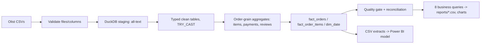

# Marketplace Operations & Customer Experience Intelligence

*An end-to-end data analytics case study: from a (simulated) business request to a tested SQL/Python pipeline.*

## Project status — read first

| Component | Status |
|---|---|
| SQL models, KPI definitions, quality checks, Python pipeline | Built; **tested on a synthetic fixture only** (16 tests pass) |
| Run on the real Olist dataset | **Not done** — Kaggle was unreachable from the authoring environment (network policy 403), so no real data was downloaded |
| Findings, data-quality results, charts | **Pending** — none are reported because none were computed from real data |
| Power BI `.pbix` | **Not built** (no Power BI Desktop). Model and DAX are specified in [`powerbi/`](powerbi/README.md), unexecuted |
| Published to GitHub | See the hand-off notes from the author; this repo was built locally |

## The simulated request
Marketplace leadership wants to know how orders and sales develop, how reliable deliveries are, whether late deliveries show up in reviews, how many customers return, and which sellers/segments need attention. See [business request](docs/business_request.md) (fictional; no real company or stakeholder) and [project charter](docs/project_charter.md).

## Data source
[Brazilian E-Commerce Public Dataset by Olist](https://www.kaggle.com/datasets/olistbr/brazilian-ecommerce) (~100k orders, 2016–2018; actual range is derived at run time). Attribution: Olist. Kaggle lists the licence as CC BY-NC-SA 4.0 — verify at download. The MIT licence in this repo covers only my code/docs, not the data. Raw data is not committed. Download: [`data/raw/README.md`](data/raw/README.md).

## Workflow

Data model: [`docs/data_model.md`](docs/data_model.md).

## Analytical controls
- Items, payments and reviews are **aggregated to order grain before joining**; tests prove totals reconcile to the raw tables and demonstrate that a naive join inflates them.
- Delivery KPIs use only *delivery-eligible* orders; missing timestamps are never counted as on time.
- Repeat purchase uses `customer_unique_id`. Seller rankings need ≥30 eligible orders.
- "Product sales value" is item price, not revenue/profit. Freight and payments are reported separately.

KPI definitions: [`docs/kpi_dictionary.md`](docs/kpi_dictionary.md) · Traceability: [`docs/requirements_traceability.md`](docs/requirements_traceability.md) · Method: [`docs/methodology.md`](docs/methodology.md) · Limits: [`docs/assumptions_and_limitations.md`](docs/assumptions_and_limitations.md).

## Run it
```bash
python -m venv .venv && source .venv/bin/activate
make setup
make test        # synthetic fixture, no real data needed
make pipeline    # needs real CSVs in data/raw/
```
Outputs: `reports/q0*.csv`, `reports/data_quality_results.csv`, `reports/charts/`, `data/processed/*.csv` (for Power BI). If data is missing, the pipeline exits with a clear error naming the missing files.

## Structure
`sql/` numbered layers (staging → transformations → marts → analysis → data quality) · `src/` pipeline, validation, QA, analysis · `tests/` pytest + synthetic fixture generator · `docs/` · `powerbi/` model spec and DAX · `.github/workflows/tests.yml` (CI defined; not yet run on GitHub).

## Skills demonstrated
Requirements and KPI definition, grain-aware SQL (DuckDB), pandas/Python pipeline design, data-quality engineering and reconciliation testing, dimensional modelling, DAX design, documentation of limitations.

## Findings and recommendations
Pending a real-data run: [`docs/findings_and_recommendations.md`](docs/findings_and_recommendations.md).
