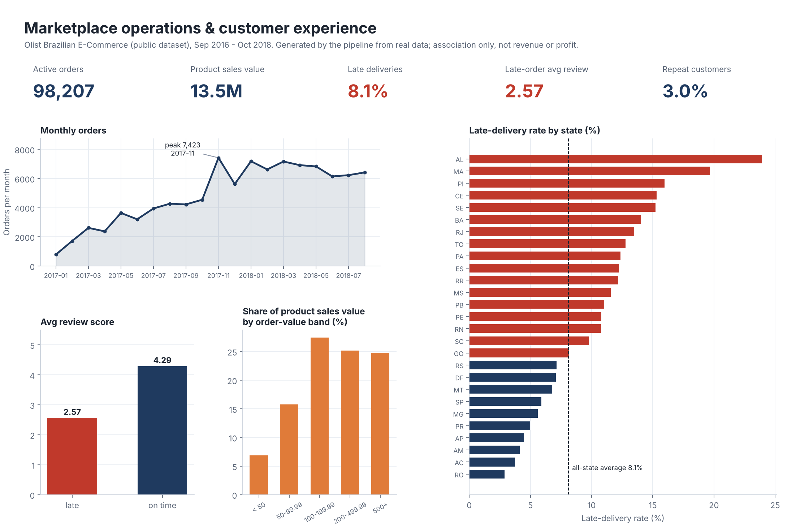
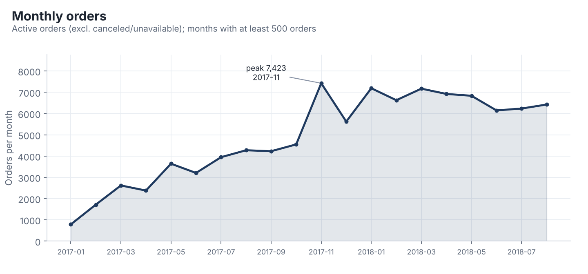
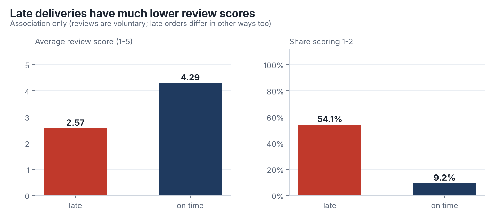
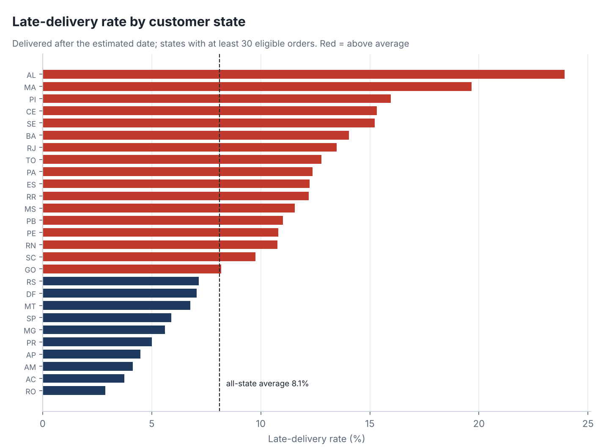
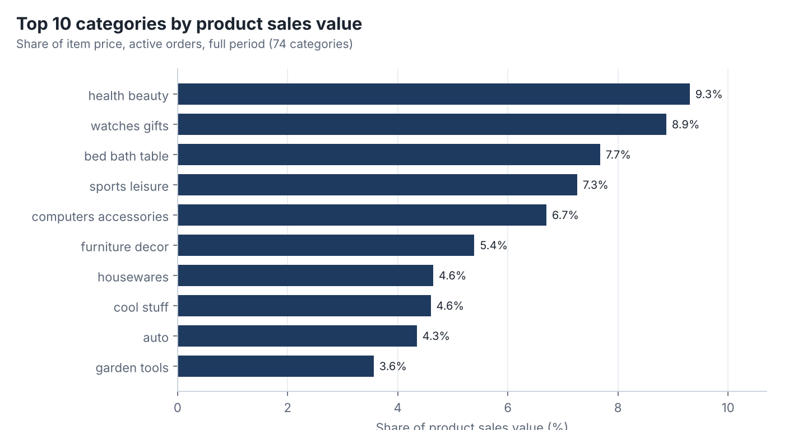
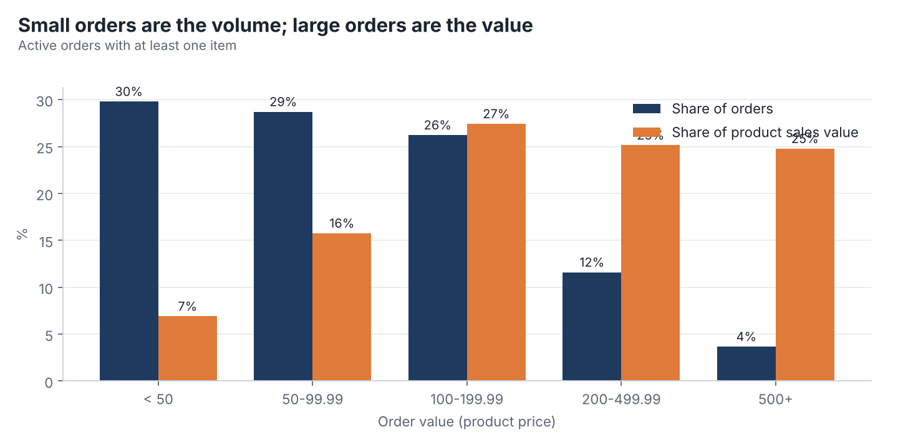
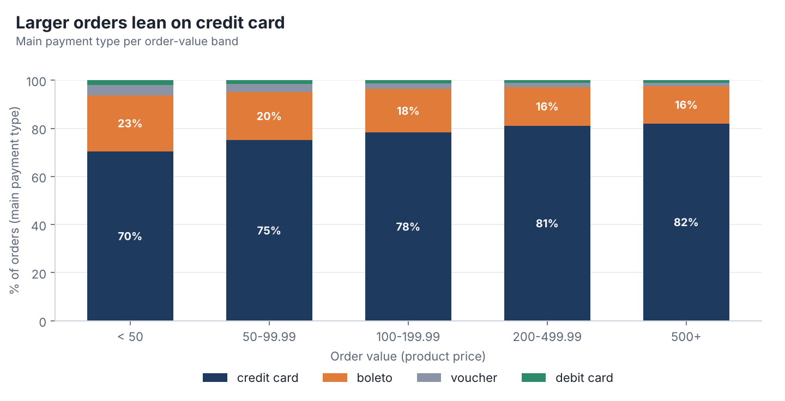

<h1 align="center">Marketplace Operations &amp; Customer Experience Analytics</h1>
<p align="center"><em>An end-to-end analytics case study on ~100k real e-commerce orders: SQL (DuckDB) + Python pipeline, data-quality gates, 13 business queries, findings and recommendations.</em></p>

<p align="center">
  
  
  
  
</p>

<p align="center"></p>
<p align="center"><sub>Overview image generated by the pipeline from the real data (<code>python -m src.pipeline</code>). It is a static Matplotlib summary, <b>not</b> a Power BI dashboard.</sub></p>

**Jump to:** [Results](#key-results) · [Status](#project-status) · [Workflow](#workflow) · [Run it](#run-it) · [Docs](#documentation)

## Key results
Descriptive associations from the real data, not causal claims; "product sales value" is item price, not revenue or profit. Full detail, denominators and caveats: [`docs/findings_and_recommendations.md`](docs/findings_and_recommendations.md).

| | Finding | Source |
|---|---|---|
| Growth | Jan-Aug 2018 vs Jan-Aug 2017: orders **+137%** (22,562 → 53,531); flat within 2018 | `q01` |
| Delivery | **8.1%** of 96,470 eligible orders late; **AL 23.9%** vs **SP 5.9%** | `q04` |
| Reviews vs delay | Late orders average **2.57**, on-time **4.29** (association only) | `q05` |
| Repeat customers | **3.0%** of 94,990 customers ordered more than once in the window | `q06` |
| Order value | Orders ≥ 200 are **15%** of orders but **50%** of product sales value | `q09` |

<table>
<tr>
<td width="50%"></td>
<td width="50%"></td>
</tr>
<tr>
<td width="50%"></td>
<td width="50%"></td>
</tr>
<tr>
<td width="50%"></td>
<td width="50%"></td>
</tr>
</table>

## Project status
| Component | Status |
|---|---|
| SQL models, KPI definitions, quality checks, Python pipeline | Built; 19 tests pass on a **synthetic fixture** (`tests/fixtures`) |
| Run on the real Olist dataset | **Done** (data downloaded 2026-10-14; not committed). All 13 blocking quality checks pass; see [data quality report](docs/data_quality_report.md) |
| Findings and recommendations | **Done** for 13 queries, association only: [`docs/findings_and_recommendations.md`](docs/findings_and_recommendations.md) |
| Charts | 6 charts in [`reports/charts/`](reports/charts) generated from the real data |
| Exploratory notebook | [`notebooks/01_exploratory_data_analysis.ipynb`](notebooks/01_exploratory_data_analysis.ipynb), executed on the real data |
| Power BI `.pbix` | **Not built** (no Power BI Desktop). Model and DAX are specified in [`powerbi/`](powerbi/README.md), unexecuted |
| GitHub Actions | Workflow defined (`.github/workflows/tests.yml`, synthetic fixture only); not verified to have run |

## The simulated request
Marketplace leadership wants to know how orders and sales develop, how reliable deliveries are, whether late deliveries show up in reviews, how many customers return, and which sellers/segments need attention. See [business request](docs/business_request.md) (fictional; no real company or stakeholder) and [project charter](docs/project_charter.md).

## Data source
[Brazilian E-Commerce Public Dataset by Olist](https://www.kaggle.com/datasets/olistbr/brazilian-ecommerce) (~100k orders, 2016–2018; actual range is derived at run time). Attribution: Olist. Kaggle lists the licence as CC BY-NC-SA 4.0 — verify at download. The MIT licence in this repo covers only my code/docs, not the data. Raw data is not committed. Download: [`data/raw/README.md`](data/raw/README.md).

## Workflow

Data model: [`docs/data_model.md`](docs/data_model.md).

## Analytical controls
- Items, payments and reviews are **aggregated to order grain before joining**; tests prove totals reconcile to the raw tables and demonstrate that a naive join inflates them.
- Delivery KPIs use only *delivery-eligible* orders; missing timestamps are never counted as on time.
- Repeat purchase uses `customer_unique_id`. Seller rankings need ≥30 eligible orders.
- "Product sales value" is item price, not revenue/profit. Freight and payments are reported separately.

KPI definitions: [`docs/kpi_dictionary.md`](docs/kpi_dictionary.md) · Traceability: [`docs/requirements_traceability.md`](docs/requirements_traceability.md) · Method: [`docs/methodology.md`](docs/methodology.md) · Limits: [`docs/assumptions_and_limitations.md`](docs/assumptions_and_limitations.md).

## Run it
```bash
python -m venv .venv && source .venv/bin/activate
make setup
make test        # synthetic fixture, no real data needed
make data        # optional: download the real CSVs (see data/raw/README.md)
make pipeline    # needs real CSVs in data/raw/
```
Outputs: `reports/q*.csv`, `reports/data_quality_results.csv`, `reports/charts/`, `data/processed/*.csv` (for Power BI). If data is missing, the pipeline exits with a clear error naming the missing files.

## Documentation
[Business request](docs/business_request.md) · [Charter](docs/project_charter.md) · [Data quality report](docs/data_quality_report.md) · [Findings](docs/findings_and_recommendations.md) · [KPI dictionary](docs/kpi_dictionary.md) · [Data model](docs/data_model.md) · [Methodology](docs/methodology.md) · [Traceability](docs/requirements_traceability.md) · [Reproducibility](docs/reproducibility.md)

## Structure
`sql/` numbered layers (staging → transformations → marts → analysis → data quality) · `src/` pipeline, validation, QA, analysis · `tests/` pytest + synthetic fixture generator · `notebooks/` EDA · `reports/` query outputs and charts · `docs/` · `powerbi/` model spec and DAX · `.github/workflows/tests.yml` (CI defined; synthetic fixture only).

## Skills demonstrated
Requirements and KPI definition, grain-aware SQL (DuckDB), pandas/Python pipeline design, data-quality engineering and reconciliation testing, dimensional modelling, DAX design, documentation of limitations.


