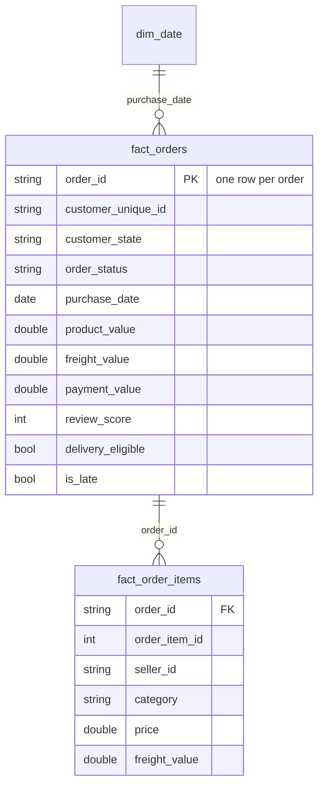

# Data model

Grains: `fact_orders` = order; `fact_order_items` = order item. Payments and reviews are aggregated into `fact_orders`; raw payment records are available in `clean_payments` for the payment-type analysis (q08).
